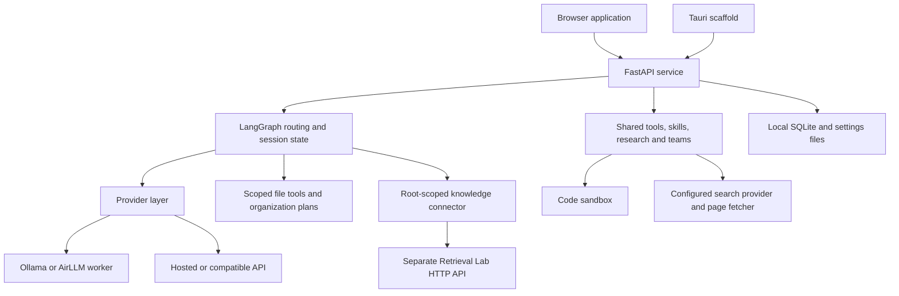

# Chat Software

A local-first AI assistant for chat, scoped file management, document questions, web research, and agent collaboration.

Chat Software brings model selection, reusable skills, sandboxed code execution, and saved conversations into one workspace. Run local models through Ollama or the optional AirLLM integration, or choose a hosted API when you need it. File access is limited to directories you explicitly approve.

[Getting started](#getting-started) · [Model providers](#model-providers) · [Architecture](#architecture) · [Permissions and privacy](#permissions-and-privacy) · [Development](#development) · [Limitations](#validation-and-current-limitations)

## Project status

The **FastAPI-served browser application** is the primary interface. A separate **Tauri 2 desktop scaffold** is included, but does not yet have feature parity with the browser application. This repository contains application source and local development instructions; publishing it on GitHub does not deploy a hosted service or produce a packaged desktop release.

## What you can do

| Capability | What is implemented |
| --- | --- |
| Chat and conversation history | Choose a provider/model; retain recent conversation context; search, rename, pin, archive, restore, or delete saved conversations. |
| Scoped file tools | List, read, search, create, edit, copy, and move files within server-approved roots; inspect Git status and diffs. |
| File organization | Preview a stored organization plan, apply it explicitly, and use journal-backed undo where supported. |
| Document questions | Connect an approved root to a Retrieval Lab workspace and receive answers with source citations, including page or row references when available. |
| Document submission | Preview selected files and their destination, then approve submission using a separate workspace-scoped ingestion credential. |
| Skills | Use eight built-in skills, duplicate them, or create reusable Markdown instructions with selected tools. |
| Code sandbox | Execute Python, Bash, or JavaScript in an available isolated backend, with timeouts and output limits. |
| Web research | Plan, search, read pages, collect notes, and produce a cited report using a configured search provider. |
| Agent teams | Define teams of up to eight members with roles, skills, tools, and budgets; run delegated tasks or moderated discussions. |
| Runtime visibility | See tool activity and progress through streamed events in the interface. |

## Getting started

### Requirements

- Python **3.10 or newer** and `pip` for the application.
- A model provider: **Ollama** is the default; hosted APIs are optional.
- Internet access for installing dependencies and downloading models. After setup, local-model chat can run without a hosted API. Web research and remote providers require network access.
- Node.js, Rust, and Docker are **not required** to start the primary browser application. They are used by optional development or execution paths below.

The shell commands below use macOS/Linux syntax. On Windows, activate the environment with `.venv\Scripts\Activate.ps1` in PowerShell.

### 1. Install and start the application

```bash
git clone https://github.com/Sayan836/Chat_Software.git
cd Chat_Software/app
python3 -m venv .venv
source .venv/bin/activate
python -m pip install -e ".[test]"
python main.py
```

Open **[http://127.0.0.1:8765/](http://127.0.0.1:8765/)**. The browser UI and API run in the same process; no frontend build is needed for this path. Stop the server with `Ctrl+C`.

If port `8765` is occupied, the launcher selects the next available port and prints its URL. Set `CHAT_SOFTWARE_STRICT_PORT=1` to fail instead of selecting another port.

Useful endpoints while the server is running:

- [`/health`](http://127.0.0.1:8765/health): application health and selected provider/model.
- [`/docs`](http://127.0.0.1:8765/docs): interactive API documentation.

### 2. Connect a model

For the default local path, install [Ollama](https://ollama.com/), start its service, and download a model that fits your hardware. The application's configured default is `qwen3:8b`:

```bash
ollama pull qwen3:8b
```

This command downloads model weights. You can also use the app's model controls to discover installed models or initiate a download. Ollama is expected at `http://localhost:11434` by default.

For hosted models, open **Settings**, enter the provider credentials, and select a model available to your account. A model connection is required for generated chat responses; the server itself can start without one.

For a deterministic smoke check without a model, stop the server and launch:

```bash
CHAT_SOFTWARE_OFFLINE_ECHO=1 python main.py
```

Echo mode checks application plumbing; it does not generate AI answers.

### 3. Try a workflow

1. Select a provider and model, then send a chat message.
2. Approve a disposable folder and attach it to the conversation to try file search or editing.
3. Request an organization preview and inspect the proposed moves before applying it.
4. Select a skill, or open **Sandbox** to check available execution backends.
5. Configure a search provider before trying live web research. Document mode requires the separate service described below.

Use copies of important files when first testing write and organization workflows.

## Model providers

| Provider | Setup | Notes |
| --- | --- | --- |
| Ollama | Local service and an installed model | Default provider; supports local model discovery and user-initiated downloads, including supported Hugging Face GGUF repositories. |
| OpenAI | API key; optional endpoint override | Uses the OpenAI-compatible chat client. |
| Anthropic | API key; optional endpoint override | Uses the native Anthropic client. Native Anthropic tool calling is not wired into this client; shared tools use the app's text-based action protocol. |
| OpenAI-compatible | Base URL, model ID, and a key if required | Supports endpoints exposing the expected chat-completions contract, including local model servers. Compatibility depends on the endpoint and model. |
| AirLLM | Separate runtime and a supported full checkpoint | Optional layer-streaming inference; see the requirements below. |

Provider configuration is centralized in [`provider/`](app/backend/chat_software/provider/). The shared tool loop uses a JSON-in-text action protocol so it can work with models that lack native function calling. Tool selection and answer quality still depend on the chosen model.

### AirLLM and Hugging Face models

There are two different local model paths:

- **GGUF weights → Ollama.** Use the Ollama/Hugging Face model controls.
- **Supported Transformers checkpoints → AirLLM.** Use **Settings → AirLLM** to set up its separate runtime, check a repository, download a checkpoint, or register one already on disk.

AirLLM is kept out of the application's Python environment. Its setup helper installs a pinned upstream revision and dependencies in a separate environment; setup and model downloads are user-initiated operations.

Important constraints:

- The architecture check is preliminary validation, not a guarantee that every `ForCausalLM` checkpoint will run.
- Layer streaming reduces resident model-memory requirements; it does not remove the need to store the weights. The app estimates roughly **twice the checkpoint weight size**, plus overhead, for weights and layer-split files.
- The CPU backend is the conservative starting path. Metal is restricted to supported Llama-family checkpoints without tied embeddings; CUDA requires suitable hardware and runtime support.
- Draft/speculator checkpoints, such as `RadixArk/Kimi-K3-DSpark`, are not standalone chat models and are rejected by the current integration.
- Gated repositories require an appropriate Hugging Face token and acceptance of their terms.
- Large checkpoints can be slow. Running a model larger than RAM has not been validated for this application.

The integration includes a pinned [upstream manifest](app/integrations/airllm/upstream.json), [runtime requirements](app/integrations/airllm/requirements.txt), and [macOS CPU patch](app/integrations/airllm/patches/cpu-on-macos.patch).

## Document questions and ingestion

Document mode connects to **Hybrid Retrieval Lab**, maintained separately in the `SemanticSearchPlatform` project. It is optional: ordinary chat does not require the retrieval service.

Chat Software owns the conversation, provider selection, permissions, and answer presentation. The retrieval service owns parsing, chunking, embeddings, indexing, and ranking. Integration is over HTTP; those engines are not bundled into this repository.

To enable document questions:

1. Run a compatible Retrieval Lab service and issue a workspace-scoped read key (`hrk_`).
2. Configure `CHAT_SOFTWARE_KNOWLEDGE_URL` and `CHAT_SOFTWARE_KNOWLEDGE_API_KEY` in the server environment.
3. Approve a local root and bind it to a workspace visible to that credential.
4. Enable **Answer from bound documents** for the conversation.

Document evidence is treated as untrusted content. Answers must cite the supplied evidence; missing or insufficient evidence produces a refusal, and uncited generated answers are not presented. Root and binding authorization are rechecked before each search or source open. Revoking a root also revokes its knowledge binding.

For file submission, configure a separate `CHAT_SOFTWARE_KNOWLEDGE_INGEST_KEY` (`hik_`) for the same workspace. The app previews files and the destination before approval, then rechecks permissions and file fingerprints before sending. Submitted retrieval jobs currently cannot be cancelled through this connector.

See the [application guide](app/README.md#documents-mode-hybrid-retrieval-lab-connector) for endpoint details.

## Architecture



| Layer | Location |
| --- | --- |
| Browser UI and launcher | [`app/web/`](app/web/), [`app/main.py`](app/main.py) |
| API service and feature endpoints | [`server.py`](app/backend/chat_software/server.py), [`api/`](app/backend/chat_software/api/) |
| Routing, agents, checkpoints, and tool loop | [`agent/`](app/backend/chat_software/agent/) |
| Scoped paths, file tools, and organization | [`tools/`](app/backend/chat_software/tools/), [`organize/`](app/backend/chat_software/organize/) |
| Retrieval and ingestion clients | [`knowledge/`](app/backend/chat_software/knowledge/) |
| Skills, research, and teams | [`skills/`](app/backend/chat_software/skills/), [`research/`](app/backend/chat_software/research/), [`teams/`](app/backend/chat_software/teams/) |
| Code execution backends | [`sandbox/`](app/backend/chat_software/sandbox/) |
| Optional AirLLM worker and setup | [`app/integrations/airllm/`](app/integrations/airllm/) |
| Desktop scaffold | [`app/src-tauri/`](app/src-tauri/), [`app/frontend/`](app/frontend/) |

## Permissions and privacy

- **Local-first is a configuration choice.** Local model inference avoids a hosted model API; remote providers, web search, and remote retrieval send the relevant requests or selected content to those services.
- **File tools require approved roots.** Resolved paths are checked against those roots. Organization plans have an explicit apply step and a journal for supported undo operations. Root approval does not make model-generated edits infallible.
- **Sandbox execution is separate from file access.** Docker uses a workspace mount, no network, a read-only root filesystem, and resource limits. The macOS Seatbelt backend restricts network access and filesystem operations. Actual availability depends on the host.
- **No silent unisolated fallback.** Plain-process execution requires `CHAT_SOFTWARE_SANDBOX_ALLOW_UNISOLATED=1`; leave it disabled when isolation is required.
- **Credentials stay server-side.** App-entered keys are stored in `<state_dir>/secrets.json` with owner-only permissions. This is plaintext storage, not a system keychain or encrypted vault. Environment variables are also supported; keep real credentials out of Git.
- **State stays on disk.** Conversations, settings, skills, checkpoints, and execution artifacts can contain sensitive information. Protect the state directory and review logs before sharing them.
- **Use the server on a trusted local machine.** It binds to loopback by default and is not an authenticated multi-user hosting service. Do not expose it directly to the internet.
- **No desktop-control permission is requested.** GUI automation and OpenGCUA integration are not implemented.

The standalone read-only MCP server is a separate integration surface. Configure its roots explicitly; do not assume it shares the browser service's approval database.

## Configuration

Most provider and search settings can be entered in **Settings**. The following environment variables are useful for server startup and optional integrations; see [the example configuration](app/.env.example) and provider code for the full set. Do not commit a populated `.env` file.

| Variable | Purpose |
| --- | --- |
| `LLM_PROVIDER` | Default provider; `ollama` when unset. |
| `OLLAMA_MODEL`, `OLLAMA_BASE_URL` | Local model and Ollama endpoint overrides. |
| `OPENAI_API_KEY`, `ANTHROPIC_API_KEY` | Hosted provider credentials. |
| `COMPATIBLE_BASE_URL`, `COMPATIBLE_MODEL`, `COMPATIBLE_API_KEY` | Compatible endpoint configuration. |
| `CHAT_SOFTWARE_HOST`, `CHAT_SOFTWARE_PORT` | Bind address and requested port; defaults are `127.0.0.1:8765`. |
| `CHAT_SOFTWARE_STATE_DIR` | State location; defaults to `.chat_software_state` relative to the launch directory. |
| `CHAT_SOFTWARE_OFFLINE_ECHO` | Set to `1` for deterministic no-model smoke checks. |
| `CHAT_SOFTWARE_SANDBOX_BACKEND` | Explicit sandbox choice: `docker`, `seatbelt`, or separately opted-in `process`. |
| `SEARXNG_URL`, `BRAVE_SEARCH_API_KEY`, `TAVILY_API_KEY` | Configure a web search provider. |
| `RESEARCH_SEARCH_PROVIDER` | Select `searxng`, `brave`, or `tavily` among configured providers. |
| `AIRLLM_HOME`, `AIRLLM_PYTHON`, `AIRLLM_BACKEND` | Optional AirLLM storage, interpreter, and backend settings. |
| `HF_TOKEN` | Access to Hugging Face repositories requiring authentication. |
| `CHAT_SOFTWARE_KNOWLEDGE_URL`, `CHAT_SOFTWARE_KNOWLEDGE_API_KEY` | Retrieval service URL and read-scoped credential. |
| `CHAT_SOFTWARE_KNOWLEDGE_INGEST_KEY` | Separate workspace-scoped submission credential. |

## Development

### Backend tests

With the application environment activated, run from `app/`:

```bash
python -m pytest backend/tests -v
```

Install the package with its `[test]` extras first. Tests include scripted providers, API contracts, file-scope enforcement, organization, retrieval/ingestion contracts, sandbox paths, and process-level server checks. Some integration tests skip when their external runtime or service is unavailable; a passing scripted test is not evidence of real-model quality.

To exercise the retrieval connector against a local Retrieval Lab checkout and its test fixtures:

```bash
CHAT_SOFTWARE_RETRIEVAL_LAB_ROOT=/path/to/SemanticSearchPlatform \
  python -m pytest backend/tests/test_knowledge_live.py -v
```

This requires the separate checkout and its dependencies. The fixture uses synthetic documents and lightweight retrieval components; it checks integration rather than production retrieval quality.

The [CI workflow](.github/workflows/ci.yml) defines backend jobs for Python 3.10/3.12 on Linux, macOS, and Windows, plus a frontend build. Its latest execution status is available in [GitHub Actions](https://github.com/Sayan836/Chat_Software/actions/workflows/ci.yml).

### Frontend and desktop scaffold

For the separate Vite/TypeScript frontend, use Node.js **20.19+ within the 20.x line, or 22.12+** as required by the locked Vite version:

```bash
cd app
npm ci
npm run dev
```

The Vite frontend runs at `http://127.0.0.1:5173` and needs the Python backend running separately. It serves the earlier frontend scaffold, not the full `app/web/` interface. Use `python main.py` for the primary application.

```bash
npm run build
npm run tauri dev
```

Tauri development additionally requires Rust/Cargo and the platform's native build prerequisites. The scaffold does not start or bundle the Python service automatically; keep the backend running separately. No signed desktop installer is supplied by the current repository configuration.

## Validation and current limitations

The [execution record](migration-execution-record.md) preserves dated local validation, including scripted/API tests, browser workflows with Ollama, retrieval integration fixtures, and small existing-checkpoint AirLLM runs. Those records are historical evidence, not a claim that the latest hosted CI or every provider/backend has passed.

Current limitations include:

- Browser and native-shell feature parity is incomplete.
- Hosted provider verification and live search depend on configured services; not every combination has been exercised.
- Fresh AirLLM runtime setup, actual checkpoint downloading, larger-than-RAM inference, CUDA, and a compatible Metal checkpoint were not validated in the recorded AirLLM acceptance run.
- Team runs with local models can be slow, and tools or citations still require human review.
- There is no general guarantee that disconnecting a browser cancels in-flight model/tool work. AirLLM's worker has its own generation cancellation controls; submitted retrieval jobs cannot be cancelled.
- A repository architecture check cannot establish model quality, runtime compatibility, or computer-use capability.
- Desktop observation/control, OpenGCUA integration, and a production multi-user deployment are outside the implemented scope.

## Documentation

- [Application guide and API overview](app/README.md)
- [Architecture and implementation plan](architecture-and-implementation-plan.md)
- [File organization design](phase-2-file-organization-design.md)
- [Agent orchestration plan](phase-3-agentic-orchestration-plan.md)
- [Migration and validation execution record](migration-execution-record.md)
- [Reference projects and provenance](reference-repos.md)

Planning and historical audit documents may describe earlier revisions or unimplemented work. Current source and the scope described above take precedence over their completion claims.

## License

This repository includes the [Apache License 2.0](LICENSE). Third-party libraries, optional runtimes, model weights, datasets, and separately operated services retain their own licenses and terms. The project license does not replace those terms. Review the actual dependency/model bundle and required notices before redistributing an application package.
